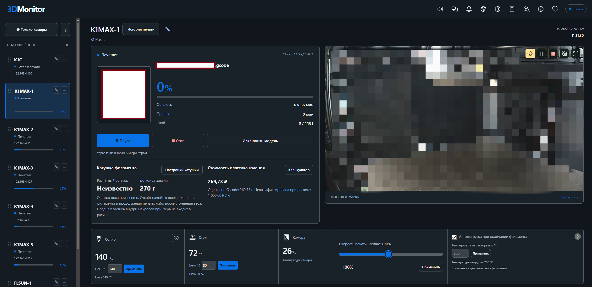
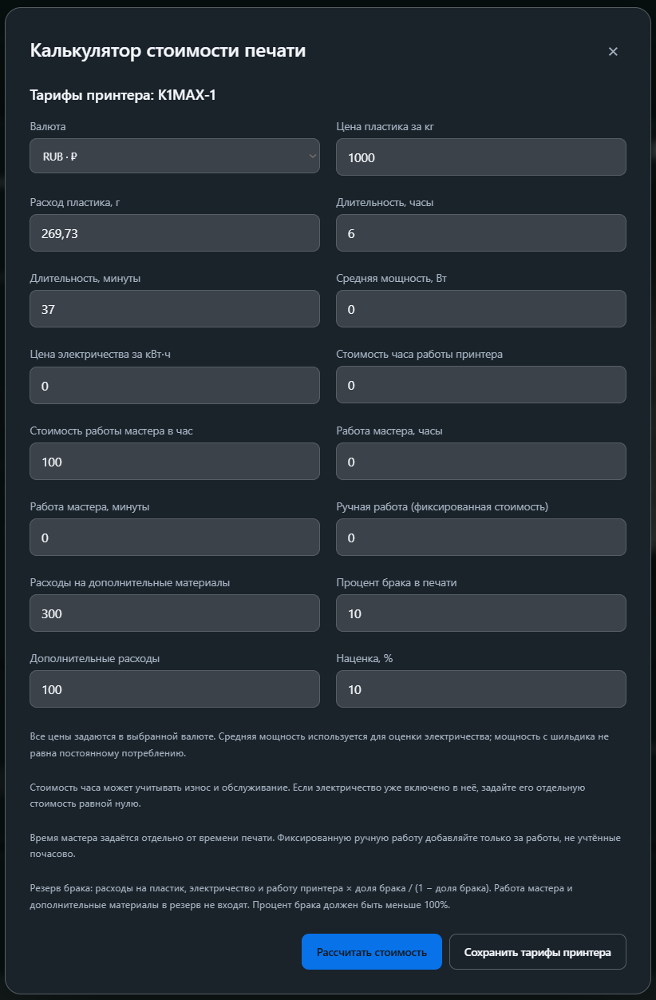
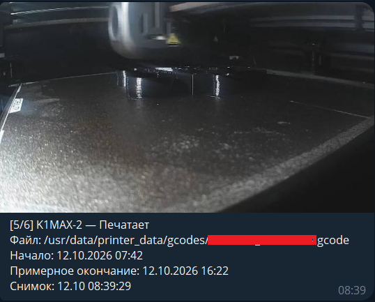

# 3DMonitor

**Keep an eye on every print. / Состояние печати под контролем.**

[Download / Скачать](https://github.com/ezimpact/3DMonitor-Releases/releases/latest) · [Telegram](https://t.me/ezimpact) · [Email](mailto:ezimpactpsn@gmail.com)

## English

**3DMonitor is a Windows application that brings your 3D printers together in one dashboard.** Follow print progress, temperatures and camera feeds, browse job history, and receive Telegram notifications.

Latest dashboard (Russian interface), with spool status and job filament cost inside the current print:

English interface example:

### Features

- **Multiple printers in one dashboard.** Connection status, progress, remaining time and temperatures, plus a dedicated camera view.

- **Telegram.** Print event notifications and status requests with camera snapshots. Commands are available in English and Russian.

- **Remote access through Tailscale.** Open the dashboard from another device after pairing it with the application.

- **Filament spool tracking.** Estimated remaining weight, low-supply warnings and automatic tracking after runout and replacement.
- **Optional nozzle temperature monitoring.** Off by default, enabled per printer.
- **Job filament cost and print cost calculator.** Printer-specific rates, RUB/USD/EUR, hourly labor, fixed work, extra materials, a failure reserve and markup.
- **Print history.** Browse recorded jobs and their results.

- **G-code files.**

- **Model preview.** Open STL, STEP and STP files directly in the application, including by dragging them onto the page.

- **Printer controls.** Use the actions supported by your printer from the dashboard.

- **Automatic filament unloading on supported printers.**

### Compatibility

The primary integration is **Creality**, including the K1 / K1C / K1 Max series. **Moonraker** is also supported. **OctoPrint** and **PrusaLink** integrations are in beta; available features depend on the printer, firmware and connection protocol.

The application runs on **Windows x64**. Printers must be reachable over the network from that computer. Remote access requires Tailscale.

### Telegram commands

Enable Telegram in 3DMonitor and pair your private chat with the bot. The application must be running. Commands work in paired private chats; group chats are not supported.

| Command | What it does |

| --- | --- |

| `/status` or `status` | Sends the status of every printer in the application's list order, the current G-code filename, print start and estimated finish times, and a camera snapshot when available. If the camera is unavailable, the bot sends a text reply. |

| `/light`, `light` or `lights` | Toggles lights on all available supported printers: if at least one has its light off, turns all eligible lights on; otherwise turns them off. |

| `/light on` or `light on` | Turns lights on for all available supported printers. |

| `/light off` or `light off` | Turns lights off for all available supported printers. |

| `/help` or `help` | Shows the command reference in English. `/start` also shows help in an already paired chat. |

| `/start <pairing code>` | Pairs the chat while pairing is active in the application. Send the temporary code shown by 3DMonitor; the code alone is also accepted. |

Status requests are limited to once every 30 seconds per chat. Wait at least 3 seconds between light commands. Printers that are offline, do not support lights or have an unknown light state are skipped. Light commands only change illumination; status and help requests read information.

Example of a `/status` reply: printer status and a camera snapshot. This supplied screenshot is from an earlier version; current replies show only the G-code filename.

### Installation and updates

Open the [latest release](https://github.com/ezimpact/3DMonitor-Releases/releases/latest), download **3DMonitor-Setup-v….exe** from **Assets**, and run the installer.

Updates preserve settings, printers, history, Telegram and paired remote devices, and create a backup before replacing files. Update controls are available in **About**. Automatic checks only report new versions; downloading and installation are initiated by the user.

### Feedback

Suggestions and bug reports: **[Telegram @ezimpact](https://t.me/ezimpact)** or ezimpactpsn@gmail.com.

## Русский

**3DMonitor — программа для Windows, которая собирает состояние ваших 3D-принтеров в одной панели.** Следите за ходом печати, температурами и камерами, просматривайте историю заданий и получайте уведомления в Telegram.

### Возможности

- **Несколько принтеров в одной панели.** Состояние подключения, прогресс, оставшееся время и температуры; отдельный режим просмотра камер.

- **Telegram.** Уведомления о событиях печати и запрос статуса со снимками камер. Команды на русском и английском.

- **Удалённый доступ через Tailscale.** Открывайте панель с другого устройства после привязки к программе.

- **Учёт катушек филамента.** Расчётный остаток, предупреждения о нехватке и начало отсчёта после окончания пластика и замены катушки.
- **Контроль температуры сопла.** Выключен по умолчанию, включается отдельно для каждого принтера.
- **Стоимость пластика задания и калькулятор печати.** Тарифы по принтеру, RUB/USD/EUR, работа мастера, фиксированная работа, материалы, резерв брака и наценка.
- **История печати.** Просматривайте сохранённые задания и их результаты.

- **Работа с G-code.**

- **Предпросмотр моделей.** Открывайте STL, STEP и STP прямо в программе, в том числе перетаскиванием на страницу.

- **Управление принтерами.** Поддерживаемые принтером действия доступны из панели.

- **Автовыгрузка филамента для поддерживаемых принтеров.**

### Совместимость

Основная интеграция — **Creality**, включая серии K1 / K1C / K1 Max. Также поддерживается **Moonraker**. Интеграции **OctoPrint** и **PrusaLink** находятся в beta; набор доступных функций зависит от принтера, прошивки и протокола подключения.

Программа запускается на **Windows x64**. Принтеры должны быть доступны с этого компьютера по сети. Для удалённого доступа нужен Tailscale.

### Команды Telegram

Включите Telegram в 3DMonitor и привяжите личный чат с ботом. Программа должна быть запущена. Команды доступны в привязанных личных чатах; в группах они не работают.

| Команда | Что делает |

| --- | --- |

| `/status`, `status` или `статус` | Присылает состояние всех принтеров в порядке списка программы, имя текущего G-code файла, время начала и примерного окончания печати, а также снимок доступной камеры. Если камера недоступна, приходит текстовый ответ. |

| `/light`, `light` или `свет` | Переключает подсветку всех доступных поддерживаемых принтеров: если хотя бы у одного свет выключен, включает его у всех; иначе выключает. |

| `/light on`, `light on` или `свет вкл` | Включает свет на всех доступных поддерживаемых принтерах. |

| `/light off`, `light off` или `свет выкл` | Выключает свет на всех доступных поддерживаемых принтерах. |

| `/help` или `помощь` | Показывает справку по командам. Английские `help` и `/help` отвечают по-английски; `помощь` и `/start` используют язык программы. |

| `/start <код привязки>` | Привязывает чат, пока в программе активна привязка. Отправьте временный код из 3DMonitor — сам код без `/start` тоже принимается. В уже привязанном чате `/start` без кода показывает справку. |

Статус можно запрашивать раз в 30 секунд для каждого чата. Между командами света нужна пауза не менее 3 секунд. Принтеры без связи, без поддержки подсветки или с неизвестным состоянием света пропускаются. Команды света меняют только подсветку; статус и справка читают информацию.

Пример ответа на «статус»: состояние принтера и снимок его камеры. Присланный скриншот сделан в предыдущей версии; сейчас в ответе отображается только имя G-code файла.

### Установка и обновление

Откройте [последний выпуск](https://github.com/ezimpact/3DMonitor-Releases/releases/latest), скачайте файл **3DMonitor-Setup-v….exe** из раздела **Assets** и запустите установщик.

Настройки, принтеры, история, Telegram и удалённые привязки сохраняются при обновлении; перед заменой файлов создаётся резервная копия. Обновления доступны в **«О программе»**. Автоматическая проверка только сообщает о новой версии; скачивание и установка запускаются пользователем.

Исходный код программы, тесты и файлы сборки установщика доступны в [work/](work/). Инструкция самостоятельного запуска и сборки — [BUILD.md](BUILD.md). Полный [архив исходников 0.102.1](https://github.com/ezimpact/3DMonitor-Releases/releases/download/v0.102.1/3DMonitor-Source-v0.102.1.zip) также добавлен к выпуску.

### Обратная связь

Предложения и сообщения об ошибках: **[Telegram @ezimpact](https://t.me/ezimpact)** или ezimpactpsn@gmail.com.

Changes / Изменения: [3DMonitor 0.103.3](CHANGELOG.md).
