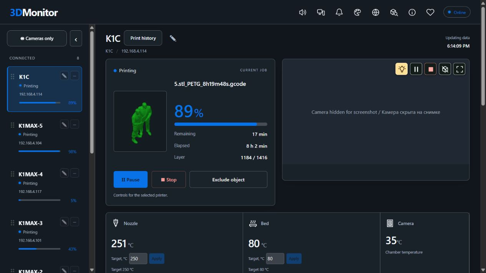
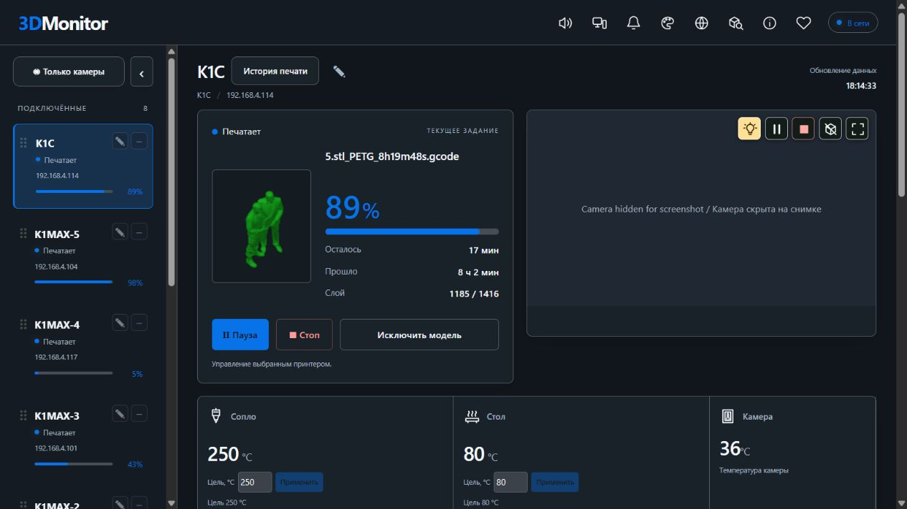
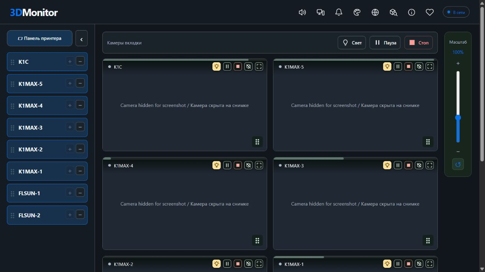

# 3DMonitor

**Keep an eye on every print. / Состояние печати под контролем.**

[Download / Скачать](https://github.com/ezimpact/3DMonitor-Releases/releases/latest) · [Telegram](https://t.me/ezimpact) · [Email](mailto:ezimpactpsn@gmail.com)

## English
**3DMonitor is a Windows application that brings your 3D printers together in one dashboard.** Follow print progress, temperatures and camera feeds, browse job history, and receive Telegram notifications.

### Features

- **Multiple printers in one dashboard.** Connection status, progress, remaining time and temperatures, plus a dedicated camera view.
- **Telegram.** Print event notifications and status requests with camera snapshots. Commands are available in English and Russian.
- **Remote access through Tailscale.** Open the dashboard from another device after pairing it with the application.
- **Print history.** Browse recorded jobs and their results.
- **G-code files.**
- **Model preview.** Open STL, STEP and STP files directly in the application, including by dragging them onto the page.
- **Printer controls.** Use the actions supported by your printer from the dashboard.
- **Automatic filament unloading on supported printers.**

### Compatibility

The primary integration is **Creality**, including the K1 / K1C / K1 Max series. **Moonraker** is also supported. **OctoPrint** and **PrusaLink** integrations are in beta; available features depend on the printer, firmware and connection protocol.

The application runs on **Windows x64**. Printers must be reachable over the network from that computer. Remote access requires Tailscale.

### Installation and updates

Open the [latest release](https://github.com/ezimpact/3DMonitor-Releases/releases/latest), download **3DMonitor-Setup-v….exe** from **Assets**, and run the installer.

Updates preserve settings, printers, history, Telegram and paired remote devices, and create a backup before replacing files. Update controls are available in **About**. Automatic checks only report new versions; downloading and installation are initiated by the user.

This repository distributes installers and application documentation. Application source code is not published here.

### Feedback

Suggestions and bug reports: **[Telegram @ezimpact](https://t.me/ezimpact)** or ezimpactpsn@gmail.com.

## Русский
**3DMonitor — программа для Windows, которая собирает состояние ваших 3D-принтеров в одной панели.** Следите за ходом печати, температурами и камерами, просматривайте историю заданий и получайте уведомления в Telegram.

### Возможности

- **Несколько принтеров в одной панели.** Состояние подключения, прогресс, оставшееся время и температуры; отдельный режим просмотра камер.
- **Telegram.** Уведомления о событиях печати и запрос статуса со снимками камер. Команды на русском и английском.
- **Удалённый доступ через Tailscale.** Открывайте панель с другого устройства после привязки к программе.
- **История печати.** Просматривайте сохранённые задания и их результаты.
- **Работа с G-code.**
- **Предпросмотр моделей.** Открывайте STL, STEP и STP прямо в программе, в том числе перетаскиванием на страницу.
- **Управление принтерами.** Поддерживаемые принтером действия доступны из панели.
- **Автовыгрузка филамента для поддерживаемых принтеров.**

### Совместимость

Основная интеграция — **Creality**, включая серии K1 / K1C / K1 Max. Также поддерживается **Moonraker**. Интеграции **OctoPrint** и **PrusaLink** находятся в beta; набор доступных функций зависит от принтера, прошивки и протокола подключения.

Программа запускается на **Windows x64**. Принтеры должны быть доступны с этого компьютера по сети. Для удалённого доступа нужен Tailscale.

### Установка и обновление

Откройте [последний выпуск](https://github.com/ezimpact/3DMonitor-Releases/releases/latest), скачайте файл **3DMonitor-Setup-v….exe** из раздела **Assets** и запустите установщик.

Настройки, принтеры, история, Telegram и удалённые привязки сохраняются при обновлении; перед заменой файлов создаётся резервная копия. Обновления доступны в **«О программе»**. Автоматическая проверка только сообщает о новой версии; скачивание и установка запускаются пользователем.

В этом репозитории размещаются установщики и описание программы. Исходный код приложения сюда не публикуется.

### Обратная связь

Предложения и сообщения об ошибках: **[Telegram @ezimpact](https://t.me/ezimpact)** или ezimpactpsn@gmail.com.

## Support / Поддержка

[Support development via lava.top](https://app.lava.top/ezimpact). Russian support options are also available in the application. / Поддержать разработку можно через раздел поддержки в программе.

## Screenshots / Скриншоты

Camera imagery is fully covered for privacy. / Содержимое видеокамер полностью закрыто.

### English interface

### Русский интерфейс

